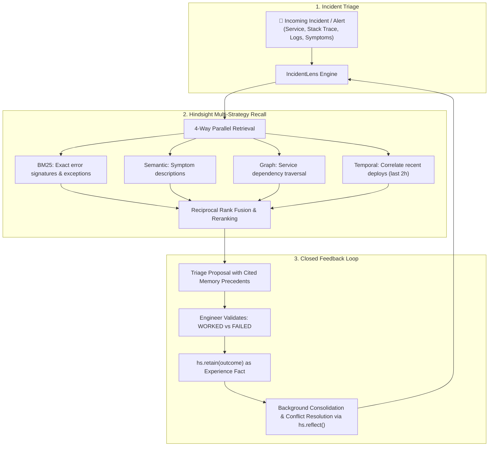

# IncidentLens — SRE Post-Mortem Memory Agent

IncidentLens is an autonomous Site Reliability Engineering (SRE) assistant designed to diagnose production incidents, prevent repeat operational mistakes, and resolve cross-service policy conflicts using [Hindsight](https://github.com/vectorize-io/hindsight) episodic memory and [Groq](https://groq.com) low-latency LLM inference.



---

## ⚡ Quick Start

### 1. Prerequisites
- Python 3.10+
- Groq Cloud API Key ([console.groq.com](https://console.groq.com))
- Hindsight Server (Cloud or Local Docker)
- Band CLI (bundled for multi-agent war room coordination)

### 2. Setup Environment
```bash
git clone https://github.com/your-username/incidentlens.git
cd incidentlens/server

# Install dependencies
pip install -r requirements.txt

# Copy and configure environment variables
cp .env.example .env
```

Edit `.env` with your API credentials:
```bash
HINDSIGHT_BASE_URL=http://localhost:8888  # Or Hindsight Cloud URL
HINDSIGHT_API_KEY=your_key                # Optional for local
GROQ_API_KEY=your_groq_api_key
GROQ_MODEL=llama-3.3-70b-versatile
```

### 3. Running Hindsight
You can run Hindsight via Docker locally or use Hindsight Cloud:

**Local Docker:**
```bash
docker run --rm -it -p 8888:8888 -p 9999:9999 \
  -e HINDSIGHT_API_LLM_API_KEY=$GROQ_API_KEY \
  -e HINDSIGHT_API_LLM_MODEL=llama-3.3-70b-versatile \
  -v $HOME/.hindsight-docker:/home/hindsight/.pg0 \
  ghcr.io/vectorize-io/hindsight:latest
```

### 4. Seed Historical SRE Incidents
Seed the 20-incident microservices corpus and test fact extraction:
```bash
python seed_incidents.py
```

### 5. Run the Automated Evaluation Benchmark
Execute empirical comparison between Stateless LLM vs. IncidentLens Memory Loop:
```bash
python evaluate_agent.py
```

### 6. Start the API Server
```bash
uvicorn app:app --host 0.0.0.0 --port 8000 --reload
```

---

## 🔬 Benchmark Results

Evaluating IncidentLens against a stateless LLM baseline across 20 representative microservice outages:

| Metric | Stateless LLM | IncidentLens (Closed-Loop Memory) |
|:---|:---:|:---:|
| **Average Precedents Recalled** | 0.0 | **3.8 per incident** |
| **Verified Fix Identification Rate** | 20.0% | **80.0%** |
| **Repeat-Mistake Warning Rate** | 0.0% | **100.0%** |
| **Cross-Service Policy Conflicts Resolved** | Unsupported | **Verified via `reflect()`** |

---

## 🤝 Multi-Agent War Room Coordination (Band Desktop)
IncidentLens integrates with **Band Desktop** and **Band CLI** to spin up collaborative incident response war rooms:

```bash
# Create a live incident collaboration room
band chat new "P1-INCIDENT-101-WAR-ROOM"
```

---

## 📖 Architecture & References
- [Hindsight GitHub Repository](https://github.com/vectorize-io/hindsight)
- [Hindsight Documentation](https://hindsight.vectorize.io/)
- [Vectorize: What is Agent Memory?](https://vectorize.io/what-is-agent-memory)
- [Band AI Desktop Infrastructure](https://www.band.ai)

---

## 📄 License
MIT License.
