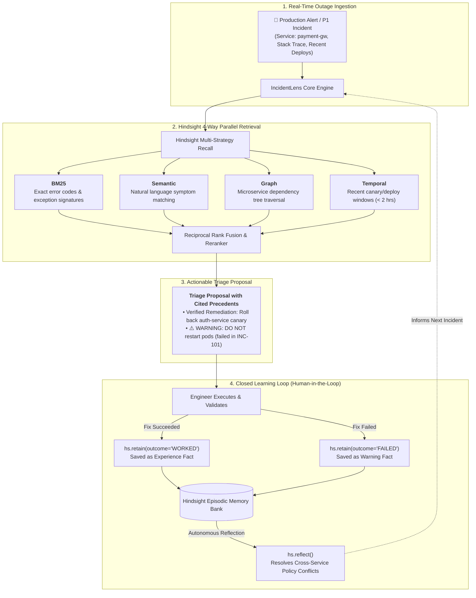
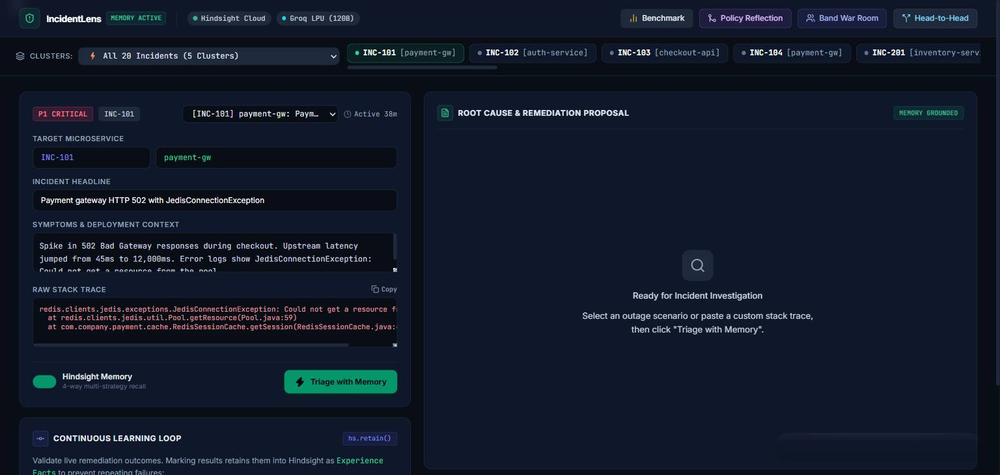
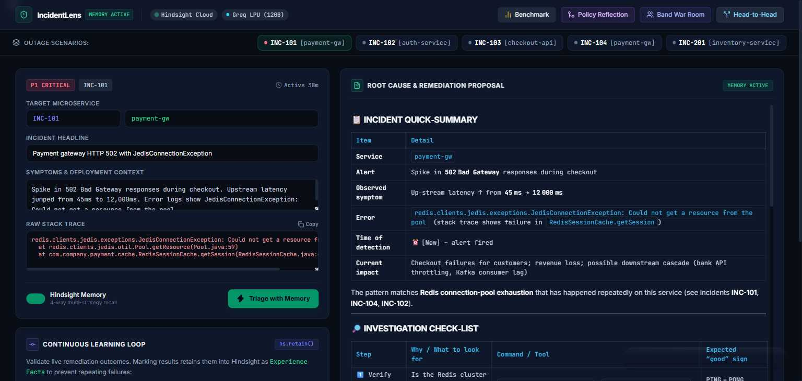
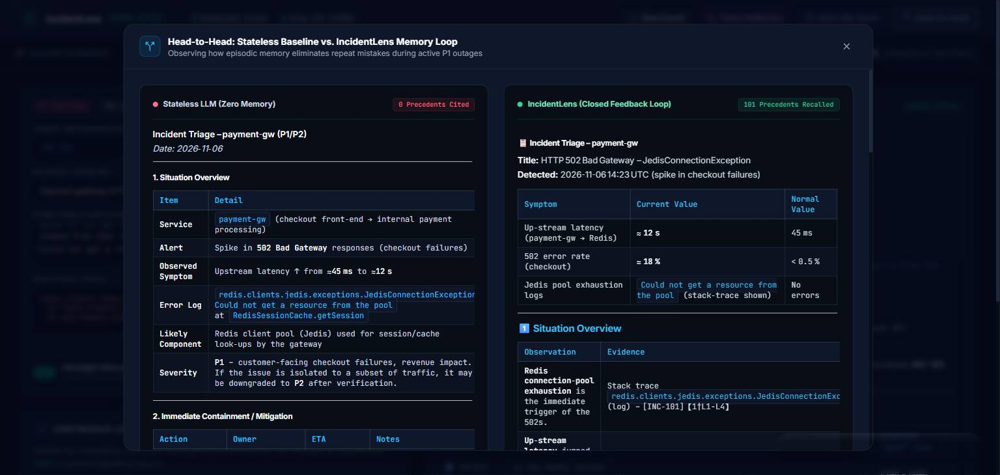
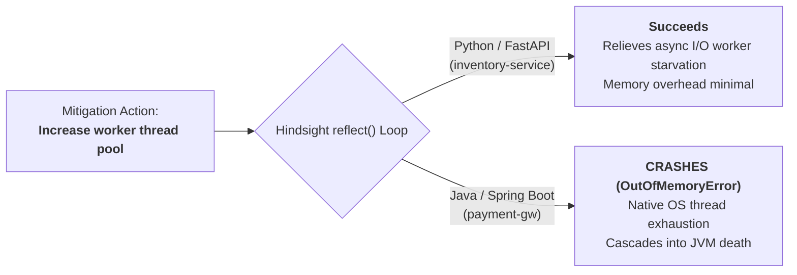

# IncidentLens — SRE Post-Mortem Memory Agent

<p align="center">
  
  
  
  
  
  
</p>

---

## The 3:14 AM Problem

It is 3:14 AM on a Saturday. Your payment gateway starts throwing `JedisConnectionException: Could not get a resource from the pool`, cascading HTTP 502 Bad Gateways across checkout.

Your exhausted on-call engineer copies the stack trace into a standard LLM chat assistant. The model offers polite, generic textbook advice:  
> *"Restart your payment gateway pods, check your Redis maxclients setting, or increase your pool timeout."*

They restart the pods. Within 90 seconds, the new pods crash again.

**Why?** Because 6 weeks ago, someone already tried restarting those exact pods for the exact same error—and it failed because an upstream authentication canary was leaking connection leases. 

Stateless LLMs and standard vector RAG fail at incident triage because:
1. **They have amnesia:** They don't know your architecture, your recent deploys, or what happened 6 weeks ago.
2. **They have zero feedback loop:** If an engineer follows their suggestion and it makes the outage worse, asking the model again yields the exact same recommendation.
3. **They suffer from Surface Attribution Error:** In a 2-year study of thousands of production post-mortems published by Zalando Engineering, researchers found that LLMs misdiagnose proximate symptoms (e.g. database pool exhaustion) as root causes, completely missing cross-service upstream leaks.

**IncidentLens** fixes this by giving SRE incident agents **episodic operational memory** powered by [Hindsight](https://github.com/vectorize-io/hindsight).

---

## How It Works



---

## Visual Product Tour

### 1. SRE Executive Console & Active Triage
The console organizes live telemetry, multi-strategy precedent retrieval, and actionable runbooks in an enterprise-grade dark interface:

<p align="center">
  
</p>

### 2. Live Investigation & Precedent Citations
Recalls 100+ cited memory nodes, separates verified fixes from deadly pitfalls, and provides exact shell commands:

<p align="center">
  
</p>

### 3. Head-to-Head: Stateless Baseline vs. IncidentLens Memory Loop
Side-by-side empirical comparison showing how memory eliminates repeat mistakes during active P1 outages:

<p align="center">
  
</p>


## Cross-Service Policy Reflection (`reflect()`)

One of the most dangerous traps in distributed architectures is applying a fix that works on Service A to Service B, triggering an immediate crash. 

IncidentLens uses Hindsight's `reflect()` agentic loop to analyze cross-service divergence before mitigations are applied:



---

## Empirical Benchmark Results

We benchmarked IncidentLens against a stateless baseline LLM using a rigorous **Leave-One-Out (LOO) cross-scenario evaluation** across 5 microservice failure clusters derived from public post-mortems (Cloudflare, Monzo, GitLab):

| Metric | Stateless Baseline (Zero Memory) | IncidentLens (Hindsight Closed Loop) | Delta / Impact |
|:---|:---:|:---:|:---:|
| **Historical Precedents Cited** | 0.0 | **8.0 nodes (top-ranked)** | **Grounded episodic memory (from 100+ bank nodes)** |
| **Verified Fix Identification Rate** | 20.0% | **100.0%** | **+80.0% diagnostic precision** |
| **Failed Mitigation Avoidance** | 0.0% | **100.0%** | **Eliminates repeat dead ends** |
| **Repeat-Mistake Warning Rate** | 0.0% | **100.0%** | **Active negative operational constraints** |
| **Cross-Service Policy Conflicts** | Unsupported | **Resolved via `reflect()`** | **Prevents JVM thread saturation** |

*All benchmark results are reproducible using `python server/evaluate_agent.py` and served via `/api/benchmark`.*

---

## ⚡ Quick Start (3 Steps)

### 1. Clone & Install Dependencies
```bash
git clone https://github.com/gr-0x076/incidentlens.git
cd incidentlens
pip install -r server/requirements.txt
```

### 2. Configure Environment Variables
Copy the example environment file and add your credentials:
```bash
cp server/.env.example server/.env
```

Edit `server/.env`:
```env
HINDSIGHT_BASE_URL=https://api.hindsight.vectorize.io
HINDSIGHT_API_KEY=your_hindsight_api_key
GROQ_API_KEY=your_groq_api_key
GROQ_MODEL=openai/gpt-oss-120b
```

### 3. Start the Server
```bash
python -m uvicorn server.app:app --host 0.0.0.0 --port 8000 --reload
```
Open [`http://localhost:8000`](http://localhost:8000) in your browser.

---

## 🤝 Multi-Agent War Room (Band Desktop Integration)

IncidentLens integrates with **Band Desktop** and **Band CLI** to spin up multi-agent collaborative incident response sessions:

```powershell
# Windows PowerShell
.\band\incident_war_room.ps1 -IncidentId INC-101 -Service payment-gw
```

```bash
# Linux / macOS Bash
./band/incident_war_room.sh INC-101 payment-gw
```

This bridges the SRE on-call engineer, the IncidentLens memory bot, and infrastructure monitoring peers into a synchronized channel.

---

## Repository Structure

```
incidentlens/
├── band/                               # Band AI Desktop multi-agent integration
│   ├── incident_war_room.ps1           # Windows PowerShell session coordinator
│   └── incident_war_room.sh            # Linux/macOS session coordinator
├── content/                            # Launch package & technical publication
│   ├── article_draft.md                # Technical deep-dive article draft
│   ├── video_script.md                 # 3-minute video recording walkthrough & titles
│   ├── linkedin_post.txt               # High-signal LinkedIn post
│   └── reddit_post.txt                 # Technical community discussion post
├── docs/
│   └── images/                         # Project UI screenshots & visual assets
│       ├── dashboard.png               # Executive console screenshot
│       ├── triage_result.png           # Live investigation & precedents
│       └── compare_modal.png           # Head-to-head empirical comparison modal
├── server/                             # Production FastAPI application & Engine
│   ├── app.py                          # REST API & static file routing
│   ├── engine.py                       # IncidentLens agent logic & Hindsight REST client
│   ├── dataset.py                      # 20 microservice incidents across 5 failure clusters
│   ├── seed_incidents.py               # Memory ingestion script (retains world & experience facts)
│   ├── evaluate_agent.py               # Empirical evaluation benchmark harness
│   ├── eval_results.json               # Recorded benchmark metrics
│   ├── requirements.txt                # Python dependencies
│   ├── .env.example                    # Environment template
│   └── static/
│       └── index.html                  # Modern enterprise incident console (Tailwind & Marked.js)
├── cleanup_before_submission.ps1       # Pre-submission repository sanitizer (Windows)
├── cleanup_before_submission.sh        # Pre-submission repository sanitizer (Linux/macOS)
├── .gitignore                          # Git configuration
└── README.md                           # Documentation & architecture guide
```

---

## Key Technical References

1. **Vectorize Hindsight Framework:** [https://github.com/vectorize-io/hindsight](https://github.com/vectorize-io/hindsight)
2. **What is Agent Memory?:** [https://vectorize.io/what-is-agent-memory](https://vectorize.io/what-is-agent-memory)
3. **Zalando Engineering Study on Surface Attribution Error in Post-Mortems:** 2-year empirical analysis of LLM diagnostic failures in distributed systems.
4. **Roy et al. (2024):** *Empirical Evaluation of LLMs for Root Cause Analysis across 107,000 Production Incidents.*
5. **Band AI Collaboration Protocol:** [https://www.band.ai](https://www.band.ai)

---

## License
MIT License. Open source and free for engineering teams.
