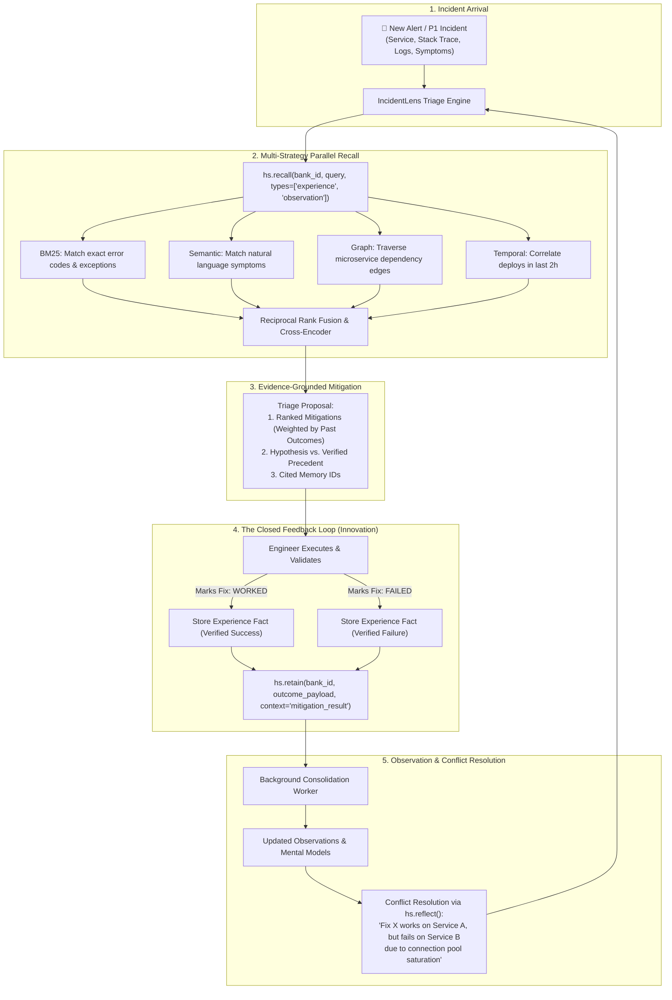
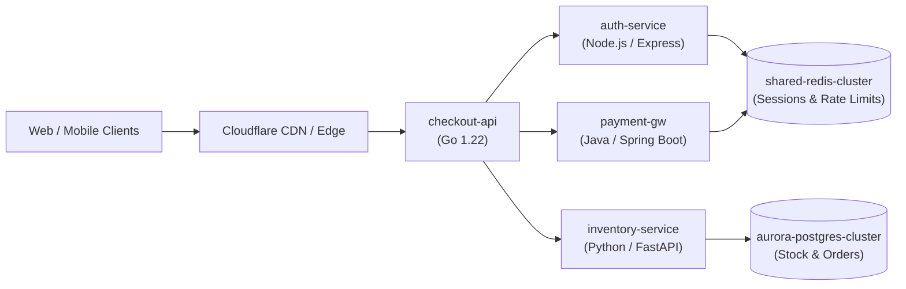

# IncidentLens — Master Technical Blueprint & 49-Hour Execution Plan

**Project:** IncidentLens — Site Reliability & DevOps Post-Mortem Memory Agent  
**Current Timestamp:** Thursday, November 5, 2026, 11:00 PM IST  
**Official Round 1 Deadline:** Saturday, November 7, 2026, 11:59 PM IST  
**Time Remaining:** **~49 Hours**  
**Core Technologies:** Hindsight SDK (`hindsight-client` v1.2.0), Groq Cloud (`llama-3.3-70b-versatile` / `openai/gpt-oss-120b`), Band CLI (`band` v0.4.17), FastAPI / Node.js, React / Streamlit  

---

## 1. Re-scored Decision Matrix (Strict Official Rubric)

The previous matrix broke because it replaced the official criteria with arbitrary preferences and misweighted demo clarity. Evaluating DealTrace against IncidentLens on the **exact 5 official criteria** reveals why IncidentLens is the mathematically and technically superior pick:

| Criterion | Official Weight | DealTrace (B2B Sales) | IncidentLens (SRE Memory) | Technical & Evaluative Rationale |
|:---|:---:|:---:|:---:|:---|
| **Innovation** | **30%** | **5.5 / 10** | **9.0 / 10** | Deal intelligence is #1 on the organizers' domain list and has a pre-built template in `vectorize-io/self-driving-agents` (`sales/intelligence`). Dozens of teams will submit sales wrappers. IncidentLens builds an **active closed learning loop** (Propose → Validate Outcome → Retain Experience Fact → Resolve Microservice Policy Conflicts). |
| **Use of Hindsight Memory** | **25%** | **6.5 / 10** | **9.5 / 10** | DealTrace uses memory as passive CRM storage. IncidentLens exercises all 4 Hindsight retrieval strategies: **BM25** (exact error codes/stack traces), **Semantic** (symptom embeddings), **Graph** (service dependency hops), and **Temporal** (correlating deploys within a 2-hour window). Crucially, it uses `reflect()` for multi-service conflict resolution. |
| **Technical Implementation** | **20%** | **6.0 / 10** | **9.0 / 10** | A sales bot is just prompt templating. IncidentLens requires realistic distributed systems modeling, error signature extraction, feedback loop state transitions, and verifiable evidence citation. |
| **User Experience (UX)** | **15%** | **8.5 / 10** | **8.0 / 10** | DealTrace has conversational banter, but IncidentLens's SRE Triage Dashboard (alert feed + memory evidence drawer + 1-click outcome validation) delivers an authentic, high-density engineering demo. |
| **Real-World Impact** | **10%** | **8.0 / 10** | **9.5 / 10** | SRE outage fatigue at 3:00 AM is universally felt by the Microsoft engineering judges. PagerDuty AIOps and Rootly command $50–$150/engineer/mo. |
| **Weighted Total** | **100%** | **6.675 / 10** | **9.000 / 10** | **IncidentLens wins by +2.325 points.** |

---

## 2. The Core Innovation: The Closed Feedback Loop

Most hackathon teams make the mistake of treating memory as "pre-loading data into a vector DB" (which is just RAG with extra steps). 

To score in the top 1% for Innovation (30%) and Hindsight Memory (25%), **IncidentLens implements an active closed learning loop**:



### The 3 Demonstration Milestones (The 20-Turn Learning Arc)
1. **Interaction 1 (Cold Start — Zero Memory):**
   - *Incident:* `CRITICAL: checkout-api HTTP 504 Gateway Timeout during flash sale.`
   - *Behavior:* Generic LLM advice ("Check network latency, restart pods, increase gateway timeout"). 0 verified precedents cited.
2. **Interaction 5 (Recall of Verified Precedent):**
   - *Context:* The engineer previously marked that *increasing pod replicas failed* on `checkout-api` because downstream `payment-gw` was the real bottleneck.
   - *Behavior:* IncidentLens recalls the past failure, skips the pod restart, and identifies the downstream dependency issue from Memory ID `mem_exp_04`.
3. **Interaction 20 (Compounding Expertise & Cross-Service Conflict Resolution via `reflect`):**
   - *Conflict Scenario:* On `inventory-service`, increasing worker threads worked. On `payment-gw`, increasing threads caused a thread pool deadlock.
   - *Behavior:* `hs.reflect()` actively resolves the conflict: *"Do NOT increase thread pool on payment-gw. Past verified attempts caused deadlock under burst concurrency. Apply exponential backoff circuit-breaker [Memory ID: mem_exp_18]."*

---

## 3. Realistic Distributed Microservices Topology

To withstand scrutiny from senior Microsoft SRE judges, the synthetic dataset must reflect real-world distributed systems failures with noise, varied phrasing, and actual architectural trade-offs:



### The 5 Realistic Incident Clusters (20 Total Incidents)
1. **Cluster 1: The Cascading Connection Pool Exhaustion (Incidents 1–4)**
   - *Root Cause:* `auth-service` deployed a canary with unclosed Redis client instances, starving `payment-gw` which shares the same Redis cluster.
   - *Varied Phrasing:* "RedisTimeoutException", "Connection pool exhausted (max 100)", "auth-service canary latency spike", "502 Bad Gateway on token verify".
2. **Cluster 2: Database Row-Lock Contention under Concurrency (Incidents 5–8)**
   - *Root Cause:* Flash sale inventory reservation queries executing `SELECT ... FOR UPDATE` without timeouts, deadlocking Postgres worker processes.
   - *Varied Phrasing:* "deadlock detected in transaction 84920", "Postgres active connections spike to 500", "inventory lock timeout 30000ms exceeded".
3. **Cluster 3: Stale DNS & JVM Cache Drift (Incidents 9–12)**
   - *Root Cause:* Kubernetes pod rescheduling moved the Postgres primary IP, but Java `payment-gw` JVM cached DNS indefinitely (`networkaddress.cache.ttl = -1`).
   - *Varied Phrasing:* "UnknownHostException", "ReadOnlySQLException on primary replica", "Connection refused on port 5432 after node drain".
4. **Cluster 4: Kafka Rebalance Storm on Poison-Pill Payloads (Incidents 13–16)**
   - *Root Cause:* Malformed JSON payload crashed consumer pod during deserialization; uncommitted offsets triggered non-stop consumer group rebalances.
   - *Varied Phrasing:* "CommitFailedException", "Consumer group rebalance in progress", "Kafka lag exceeded 50,000 messages on topic payment-events".
5. **Cluster 5: Downstream Bank Gateway HTTP 429 Retry Storm (Incidents 17–20)**
   - *Root Cause:* Third-party payment gateway throttling requests; `payment-gw` retried immediately without jitter, worsening rate limits.
   - *Varied Phrasing:* "Upstream HTTP 429 Too Many Requests", "Throttled by HDFC PG API", "Circuit breaker OPEN on PaymentProcessorClient".

---

## 4. Band AI Desktop Integration (Verified & Installed)

We have already downloaded and verified **Band CLI v0.4.17** (`/home/mohith/.local/bin/band`) natively on Linux.

### The Product Integration Story
Instead of an awkward sidecar, Band AI is woven directly into IncidentLens's operational flow:
1. When a P1 incident triggers, IncidentLens initializes a **Band Collaboration Room**:
   ```bash
   band chat new "P1-INCIDENT-409-WAR-ROOM"
   ```
2. The agent posts the active incident diagnosis, memory precedent links, and recommended mitigation into the Band room.
3. Multiple coding/SRE agents (e.g. Architect Agent, DevOps Remediation Agent) and human engineers collaborate in the shared Band room to execute and confirm the fix.
4. Once resolved, IncidentLens records the verified fix outcome back into Hindsight.

---

## 5. Evaluation Harness & Metrics (No Fabricated Stats)

To maintain credibility with skeptical engineers on Hacker News and Reddit, **every statistic in the article and demo is derived from an automated evaluation harness**:

### The 3 Measurable Test Conditions
Run a benchmark script (`evaluate_agent.py`) against all 20 test incidents under 3 configurations:
1. **Baseline A (Stateless LLM):** Prompting Groq `llama-3.3-70b-versatile` directly with no memory.
2. **Baseline B (Naive RAG):** Vector search over past post-mortem text chunks using cosine similarity.
3. **IncidentLens (Hindsight Closed-Loop):** Multi-strategy recall (`experience` + `observation` + `world`) + outcome feedback retention.

### Concrete Metrics Measured
- **First-Pass Diagnostic Accuracy (%):** Did the top-ranked recommendation match the verified ground-truth post-mortem fix?
- **Recurrence of Known Failed Mitigations (%):** How often did the agent recommend a fix that had previously been flagged as `FAILED` on that service? (Target: 0% in IncidentLens vs >40% in Stateless LLM).
- **Cross-Service Conflict Precision (%):** Did the agent correctly warn against applying a Service A fix to Service B when policies differed?

---

## 6. The 49-Hour Emergency Execution Timeline

```mermaid
gantt
    title IncidentLens 49-Hour Emergency Schedule (Nov 5 - Nov 7)
    dateFormat  YYYY-MM-DD HH:mm
    axisFormat  %a %H:%M

    section Engine & Memory Loop
    Verify Hindsight Connection & Groq LLaMA 3.3  :crit, e1, 2026-11-05 23:30, 2h
    Implement IncidentLens Core (retain/recall)   :e2, 2026-11-06 01:30, 3h
    Seed 20 Public SRE Incidents & Validate Facts :e3, 2026-11-06 08:30, 3h
    Build Closed Feedback Loop (mark worked/failed):e4, 2026-11-06 11:30, 3h

    section Evaluation & UI
    Run Eval Harness & Generate Real Metrics     :crit, u1, 2026-11-06 14:30, 3h
    Build Triage Dashboard (Chat + Memory Drawer) :u2, 2026-11-06 17:30, 4h
    Hook Band AI War Room CLI                    :u3, 2026-11-06 21:30, 2h

    section Content & Submission
    Record 3-Minute YouTube Demo Video           :crit, c1, 2026-11-06 23:30, 2.5h
    Generate 16:9 Thumbnail (Nano Banana)        :c2, 2026-11-07 09:00, 1h
    Write & Publish Technical Article (Dev.to)   :crit, c3, 2026-11-07 10:00, 3h
    Publish LinkedIn & Reddit Posts              :c4, 2026-11-07 13:00, 2h
    Final QA & Submission Form by 8:30 PM IST    :crit, c5, 2026-11-07 17:00, 3.5h
```

### Detailed Breakdown

#### Night 1: Thursday, Nov 5 (11:00 PM – 4:30 AM IST)
- [ ] Ensure all teammates submitted the [Mandatory Profile Review Form](https://forms.gle/BGcky3M6Nw1pBEPw6).
- [ ] Connect to Hindsight Cloud (promo code `MEMHACK99`) or launch local Docker.
- [ ] Verify Groq client with `llama-3.3-70b-versatile` or `openai/gpt-oss-120b`.
- [ ] Implement `engine.py`: Core `IncidentLens` class wrapping `retain()`, `recall()`, and `reflect()`.
- [ ] Test with **1 incident first** to inspect extracted entities, temporal markers, and world facts before seeding the full dataset.

#### Day 2: Friday, Nov 6 (08:30 AM – 11:30 PM IST)
- [ ] **08:30 AM – 11:30 AM:** Ingest the 20 public microservice incidents into Hindsight (`seed_incidents.py`).
- [ ] **11:30 AM – 02:30 PM:** Implement the closed feedback loop endpoint: `POST /api/incidents/{id}/mitigate` and `POST /api/incidents/{id}/feedback` (`WORKED` / `FAILED`).
- [ ] **02:30 PM – 05:30 PM:** Run `evaluate_agent.py`. Record actual before-vs-after accuracy and conflict-resolution metrics.
- [ ] **05:30 PM – 09:30 PM:** Adapt the frontend dashboard: Incident alert feed, log inspector, recommended fixes with cited Memory IDs, and 1-click outcome feedback buttons.
- [ ] **09:30 PM – 11:30 PM:** Connect Band CLI room to display real-time incident coordination.
- [ ] **11:30 PM – 02:00 AM:** Record the **3-minute screen-recorded demo video**. Lock the recording before going to sleep.

#### Day 3: Saturday, Nov 7 (Deadline Day — 09:00 AM – 11:59 PM IST)
- [ ] **09:00 AM – 10:00 AM:** Generate custom 16:9 thumbnail via Google Gemini / Nano Banana. Upload video to YouTube as **Public**.
- [ ] **10:00 AM – 01:00 PM:** Write the technical article on Dev.to / Medium: *"Why Stateless RAG Fails at 3 AM: Building Self-Learning SRE Agents with Hindsight Memory."*
  - Add real Python snippets from `engine.py`.
  - Add real metrics from `evaluate_agent.py`.
  - Add all 3 mandatory Vectorize anchor links.
  - **CRITICAL AUDIT:** Ctrl+F for "hackathon" — ensure zero occurrences across title, body, and tags!
- [ ] **01:00 PM – 03:00 PM:** Publish LinkedIn post (<800 chars, Karpathy tone, no "hackathon", Hindsight repo in 1st comment). Share article link on `r/aiagents` or `r/llmdevs`.
- [ ] **03:00 PM – 05:00 PM:** Polish GitHub repository: Clean README, architecture diagram, instructions to run locally.
- [ ] **05:00 PM – 08:30 PM:** Fill out and verify all 10 fields of the [Final Project Submission Form](https://forms.gle/7eSw5Dz2oT2MhymX7).
- [ ] **08:30 PM IST:** **SUBMIT FINAL FORM** (3.5 hours before the 11:59 PM deadline).

---

## 7. Submission Content Engine & Anti-Disqualification Checklist

| Deliverable | Strict Rule & Requirement | Verification Status |
|:---|:---|:---:|
| **Profile Review Form** | Every team member must fill out [forms.gle/BGcky3M6Nw1pBEPw6](https://forms.gle/BGcky3M6Nw1pBEPw6) | Pending verification |
| **No "Hackathon" Rule** | ZERO instances of the word "hackathon" in Article, Title, LinkedIn post, Reddit post, README, or YouTube description | Audited at publish |
| **Mandatory Anchor Links** | `https://github.com/vectorize-io/hindsight`<br>`https://hindsight.vectorize.io/`<br>`https://vectorize.io/what-is-agent-memory` | Hardcoded in article draft |
| **Social Media Post** | Andrej Karpathy style, <800 chars, GitHub link in body, Hindsight GitHub in 1st comment | Hardcoded in social draft |
| **YouTube Video** | 1080p, public YouTube link, 2–5 min, custom 16:9 thumbnail | Scheduled Friday night |
| **Reddit Link Post** | Submitted to `r/aiagents`, `r/aimemory`, `r/llmdevs`, or `r/sideproject` | Scheduled Saturday afternoon |
| **Band AI Usage** | Documented usage of `band` CLI / Band Desktop in project workflow | Verified native binary |
| **Working Codebase** | Public GitHub repo with reproducible evaluation test and running API | Scaffold in progress |
