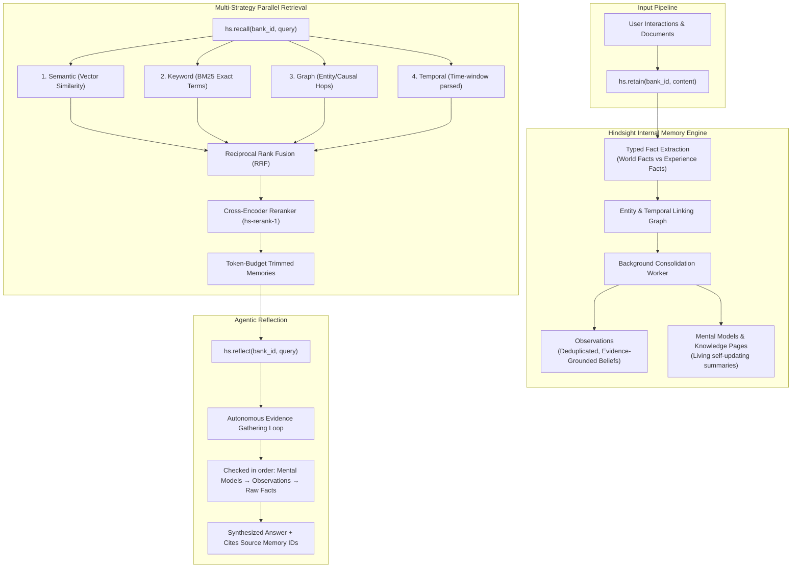
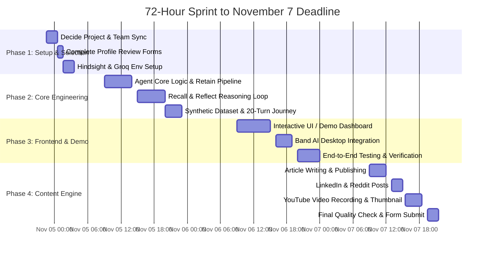

# Hack With Bangalore 4.0 — Round 1 Blueprint & Preparation Plan
**Date of Strategy Update:** November 4, 2026  
**Round 1 Submission Deadline:** **November 7, 2026, 11:59 PM IST** (~72 hours remaining)  
**Host & Offline Finale:** Microsoft Office, Bengaluru (for shortlisted teams)  
**Organizers:** Devnovate & Hack With India in partnership with Vectorize (Hindsight) and Band AI  

---

## 1. Executive Summary & The New Reality

The hackathon format has evolved following the postponement of the October 30 date:
1. **Two-Stage Funnel:** 
   - **Stage 1 (Current Phase):** Virtual project building & content submission due **Saturday, November 7 at 11:59 PM IST**.
   - **Stage 2 (Offline Grand Finale):** Shortlisted teams present live on-site at the **Microsoft Office, Bengaluru**.
2. **The Theme is Strictly Fixed:**
   - **"AI Agents That Learn Using Hindsight"**
   - All teams **must** integrate **Hindsight** (by Vectorize.io) as the core memory layer.
   - Teams must also use/download **Band AI Desktop** (`https://www.band.ai`).
3. **Explicit Directive on Ideas:**
   - The organizers explicitly warn: *"Avoid student-centric projects like AI tutors, AI group project managers, AI quiz generators, etc. Think about the professional world instead. Ask yourself: 'Would someone pay $50/month for this?'"*
4. **Mandatory Content Engine (Heavy Weight in Evaluation):**
   - Submissions require not just a GitHub repo and video, but an **Article (800–1,500 words)**, a **LinkedIn Post**, a **Reddit Link Post**, and a **YouTube Video** following strict formatting rules (e.g., **disqualification if the word "hackathon" is mentioned** in the article or social post!).
5. **Two Mandatory Forms:**
   - [Mandatory Profile Review Form](https://forms.gle/BGcky3M6Nw1pBEPw6): Every member must fill this out to be eligible for shortlisting.
   - [Final Project Submission Form](https://forms.gle/7eSw5Dz2oT2MhymX7): One submission per team by Nov 7, 11:59 PM.

---

## 2. Exhaustive Analysis of Official Documents

### A. Problem Statement Document
*Source: [Official Problem Statement](https://docs.google.com/document/d/1A4ezag02em823ZzYF34DiUVHUNLWI5ztm70QvWidWoQ/edit?usp=sharing)*

* **Core Premise:** Build AI-powered applications using Hindsight, a memory system that allows agents to remember, recall, and improve over time.
* **Why Memory Matters (25% of score):** Projects must demonstrate a **clear before-and-after contrast**:
  - *Interaction 1:* Generic baseline behavior.
  - *Interaction 5:* Contextual and personalized.
  - *Interaction 20:* Feels like a seasoned colleague with deep compounding domain expertise.
* **Technology Mandates:**
  - **Hindsight:** Required memory layer (`retain`, `recall`, `reflect`). Free $50 cloud credits via promo code `MEMHACK99` on [Hindsight Cloud](https://ui.hindsight.vectorize.io), or run locally via Docker (`ghcr.io/vectorize-io/hindsight:latest`).
  - **Band AI Desktop:** Required download at [band.ai](https://www.band.ai) (collaboration and visibility layer for coding agents).
  - **LLM Access:** Recommended fast inference on Groq (`groq.com`) using `openai/gpt-oss-120b` or `qwen/qwen3-32b` or LLaMA 3.
  - **Coding Agents Permitted:** Code.in (`https://code.in/`), Jules (`jules.google.com`), OpenCode (`opencode.ai`), Claude Code, Codex.
* **Official Judging Criteria & Scoring Weights:**

| Criterion | Weight | What Judges Look For |
|:---|:---:|:---|
| **Innovation** | **30%** | Fresh take on a real business problem; goes beyond standard chat wrappers. |
| **Use of Hindsight Memory** | **25%** | Memory is central to value proposition; agent visibly learns/improves over interactions. |
| **Technical Implementation** | **20%** | Clean architecture, handles edge cases, production code quality. |
| **User Experience (UX)** | **15%** | Intuitive interface, compelling demo flow and narrative. |
| **Real-World Impact** | **10%** | Solves genuine enterprise pain; clear willingness to pay ($50+/mo). |

* **Official Business Domains Suggested:**
  1. **Sales & Revenue:** Deal Intelligence Agent, Outbound Prospecting Agent, Proposal/RFP Agent.
  2. **Marketing & Content:** Content Strategy Agent, SEO/Citation Agent, Social Media Engagement Agent.
  3. **Engineering & DevOps:** Incident Response Agent, Code Review Agent, DevOps Pipeline Agent.
  4. **Operations & Support:** Customer Support Agent, Accounts Payable Agent, Compliance/Audit Agent.
  5. **Product & Strategy:** User Feedback Synthesizer, Competitive Intelligence Agent, Meeting Prep Agent.
* **Inspiration Repository:** [vectorize-io/self-driving-agents](https://github.com/vectorize-io/self-driving-agents).

---

### B. Content Submission Guide
*Source: [Official Content Guide](https://docs.google.com/document/d/1Spy4cclvZtWFI_ynXLcSDGBSVqb_Zjp2M1ffXqWeOXU/edit?usp=sharing)*

This is a critical differentiator. Teams failing content guidelines are disqualified or penalized.

#### 1. The Article (Per Team Member)
* **Length:** 800–1,500 words (up to 2,000 words max).
* **Platforms:** Medium, Dev.to, Hashnode, Substack, or LinkedIn Articles. (Public and linkable URL required).
* **STRICT RULE:** **DO NOT MENTION "HACKATHON" ANYWHERE IN THE ARTICLE OR TITLE.** Violators will be disqualified.
* **Angle & Tone:** Written like an experienced, skeptical senior engineer on Hacker News or TheNewStack. First-person ("I" / "we"). Concrete, no buzzwords.
* **Mandatory Contents:**
  - Real code snippets showing Hindsight integration (`retain`, `recall`, `reflect`).
  - At least one concrete before/after example showing behavior improvement.
  - At least one honest limitation or lesson learned.
  - Screenshots / architecture diagram.
  - **Mandatory Anchor Links:**
    - Hindsight GitHub: `https://github.com/vectorize-io/hindsight`
    - Hindsight Docs: `https://hindsight.vectorize.io/`
    - Vectorize Agent Memory: `https://vectorize.io/what-is-agent-memory`

#### 2. The Social Post (LinkedIn / X)
* **Length:** Under 800 characters.
* **STRICT RULE:** **NO MENTION OF "HACKATHON" OR STUDENT TAGS.**
* **Style:** Andrej Karpathy tone. Bold 2-line hook, short punchy paragraphs, 3–7 technical takeaways, before/after contrast.
* **Links:** Put your project GitHub link in the main post. Put the Hindsight repo (`https://github.com/vectorize-io/hindsight`) as the **first comment**.
* **Required Hashtags (Last line only):** `#AIAgents #AI #Hindsight #AgentMemory #AIMemory #LLM`.

#### 3. The Video (1 per Team)
* **Duration:** 2 to 5 minutes (3 minutes optimal).
* **Platform:** Public upload to **YouTube** (Google Drive links not accepted).
* **Format:** 1080p screen recording + voiceover. Talking head preferred but optional.
* **Structure:**
  - 0:00–0:30: Quick intro (who you are, what was built, why).
  - 0:30–1:00: The problem (agent failing/stateless without memory).
  - 1:00–2:30: Live demo (retain/recall/reflect in real time, clear before/after).
  - 2:30–3:00: Key takeaway & lessons.
* **Thumbnail:** 16:9 custom thumbnail created via Google Nano Banana / Gemini.

#### 4. The Reddit Post
* Submit your published article as a **Link post** on one of these subreddits:
  - `https://reddit.com/r/llmdevs`
  - `https://reddit.com/r/sideproject`
  - `https://reddit.com/r/aiagents`
  - `https://reddit.com/r/aimemory`

---

### C. The Two Submission Forms

1. **Mandatory Profile Review Form:** [https://forms.gle/BGcky3M6Nw1pBEPw6](https://forms.gle/BGcky3M6Nw1pBEPw6)
   - *Requires Google sign-in.*
   - Must be submitted by **every team member individually**. Incomplete teams are excluded from shortlisting.
2. **Final Project Submission Form:** [https://forms.gle/7eSw5Dz2oT2MhymX7](https://forms.gle/7eSw5Dz2oT2MhymX7)
   - *One submission per team by Nov 7, 11:59 PM.*
   - Required Fields:
     1. Email ID
     2. Phone Number
     3. Team Name
     4. Team Members
     5. GitHub Repository Link (or Google Drive)
     6. Social Media Post Link (LinkedIn)
     7. Article Link (Dev.to / Medium)
     8. Video Link (YouTube)
     9. Reddit Post Link
     10. Feedback

---

## 3. Deep Dive into Hindsight: How It Works

Hindsight by Vectorize is **not** a traditional vector database or RAG pipeline. Understanding this distinction is essential to scoring high on the 25% "Use of Hindsight Memory" criterion.



### The Three Foundational Methods
1. **`retain(bank_id, content, context, metadata)`**: Stores raw interactions. Instead of storing verbatim chat logs, Hindsight extracts typed facts (world facts vs experience facts), links them to entities in a graph, and flags temporal anchors.
2. **`recall(bank_id, query, types, budget)`**: Runs **4 parallel search strategies** (Semantic vector, BM25 keyword, Graph traversal, and Temporal window), merges them via Reciprocal Rank Fusion, reranks them with a cross-encoder, and trims to your token budget.
3. **`reflect(bank_id, query, context)`**: Does not just retrieve text; it runs an **agentic loop** over the memory bank to synthesize insights, resolve conflicting beliefs, and formulate an answer grounded in cited memory IDs.

### SDK Installation & Access
* **Python Client:** `pip install hindsight-client`
* **Node.js Client:** `npm install @vectorize-io/hindsight-client`
* **Cloud Instance:** Sign up at [ui.hindsight.vectorize.io](https://ui.hindsight.vectorize.io) → Billing → Promo Code: `MEMHACK99` ($50 free credit).
* **Local Docker Option:**
  ```bash
  docker run --rm -it -p 8888:8888 -p 9999:9999 \
    -e HINDSIGHT_API_LLM_API_KEY=$GROQ_API_KEY \
    -e HINDSIGHT_API_LLM_MODEL=llama-3.1-70b-versatile \
    ghcr.io/vectorize-io/hindsight:latest
  ```

---

## 4. Project Direction Decision Matrix

> [!IMPORTANT]
> **Why we must pivot from MedLens:**  
> MedLens was an OCR document parser. However, the official problem statement explicitly commands:
> 1. *"All teams must build their projects using Hindsight."*
> 2. *"Avoid student-centric projects... think about the professional world."*
> 3. *"Would someone pay $50/month for this?"*
> 4. *"Make memory the star: show the agent getting noticeably better across 10–20 interactions."*

Below are four enterprise candidates evaluated against your skills (Python, PyTorch/FAISS recommendation experience, Groq, Fast RAG, Scaler/IIT Madras coursework, and your ongoing Enterprise Assistant project).

### The 4 Candidate Projects

#### Candidate 1: DealTrace — B2B Deal Intelligence & Objection-Memory Agent (Sales Track)
* **Problem:** Sales reps spend 30% of their time reviewing CRM notes and call logs before prospect meetings. They forget objections raised 3 weeks ago by the CFO, which competitor pricing models were discussed, and which counter-arguments successfully closed similar past enterprise deals.
* **How Memory is the Star:**
  - *Turn 1:* DealTrace acts like a standard sales assistant.
  - *Turn 5:* It remembers that Acme Corp's CTO hates vendor lock-in and prefers self-hosted Docker.
  - *Turn 15:* It runs `reflect()` across 20 historical deal cycles to extract: *"When prospects compare us to Snowflake on cost, emphasizing our serverless cold-start model closes deals 40% faster than discounting."*
* **Stack:** Next.js / React + FastAPI + Hindsight (`hindsight-client`) + Groq (LLaMA 3.1 70B).

#### Candidate 2: IncidentLens — Site Reliability & DevOps Post-Mortem Memory Agent (Engineering Track)
* **Problem:** When production breaks at 3:00 AM, engineers repeat past troubleshooting mistakes. Runbooks are static, outdated markdown files. On-call engineers waste hours debugging root causes that were already diagnosed and resolved 4 months ago in a different service.
* **How Memory is the Star:**
  - Ingests past P1/P2 post-mortems, Slack war-room logs, and PR changes via `retain()`.
  - When a new incident occurs, `recall(types=["experience", "observation"])` pulls historical incident patterns, even if the error message is worded differently (Graph + Semantic + Temporal).
  - Uses `reflect()` to recommend verified mitigation steps and predict cascading failures based on accumulated operational history.
* **Stack:** React/Tailwind + FastAPI + Hindsight + Groq + Synthetic SRE incident logs.

#### Candidate 3: AuditMind — Continuous SOC2 & ISO 27001 Compliance Auditor (Operations Track)
* **Problem:** Enterprise compliance audits cost $50,000+ because teams scramble every year to gather evidence across GitHub commits, AWS policies, and HR onboarding logs.
* **How Memory is the Star:**
  - Retains security policies, exception approvals, infrastructure changes, and past auditor findings.
  - Generates living **Knowledge Pages** inside Hindsight that continuously track compliance status.
  - Can be asked: *"Did any PR in October violate our two-person code review rule?"* and answers using temporal multi-hop memory.

#### Candidate 4: TeamBrain — Enterprise Knowledge Assistant with Longitudinal Memory (Workplace Track)
* **Problem:** Existing enterprise chatbots (Slack bots) suffer from amnesia. They answer single questions but never remember your role, tech stack preferences, ongoing sprint commitments, or how past organizational decisions were reached.
* **Direct fit with your existing work:** Directly elevates your in-progress Enterprise Assistant project into a production-grade memory-powered agent.

---

### Weighted Decision Matrix

| Evaluation Criteria | Weight | Candidate 1: DealTrace (Sales) | Candidate 2: IncidentLens (DevOps) | Candidate 3: AuditMind (Compliance) | Candidate 4: TeamBrain (Workplace) |
|:---|:---:|:---:|:---:|:---:|:---:|
| **Memory as the Star (Hindsight Rubric 25%)** | 25% | 9.5/10 | 9.0/10 | 8.5/10 | 8.0/10 |
| **Demo Clarity in 60s (UX & Storytelling 15%)** | 20% | 9.5/10 | 8.5/10 | 7.5/10 | 8.5/10 |
| **Enterprise Value / Willingness to Pay ($50/mo)** | 20% | 9.0/10 | 9.0/10 | 9.5/10 | 7.5/10 |
| **Feasibility in 72 Hours** | 20% | 9.0/10 | 8.5/10 | 7.5/10 | 9.0/10 |
| **Synergy with Your Experience (RAG/Assistant)** | 15% | 8.5/10 | 8.5/10 | 7.5/10 | 9.5/10 |
| **Total Weighted Score** | **100%** | **9.15 / 10** | **8.70 / 10** | **8.15 / 10** | **8.45 / 10** |

### Analysis & Guidance for Your Decision

* **Why DealTrace is Ranked #1:** In a 2–3 minute video demo and in front of Microsoft judges, a sales scenario is immediately intuitive. Everyone understands *"Prospect X rejected pricing last week; today they're back; watch our agent recall that objection and suggest the exact winning rebuttal learned from deal #14."* It requires zero complex mock infrastructure to look real.
* **Why IncidentLens is Ranked #2:** If you prefer pure engineering / DevOps, IncidentLens is technically respected by senior engineers. Showing an agent remember a past Kubernetes OOM-kill issue and immediately save an on-call engineer from outage downtime is compelling.
* **Why TeamBrain is Feasible:** If you want to reuse concepts from your in-progress Enterprise Assistant, this requires the least conceptual friction, but you must avoid making it look like a generic chatbot by highlighting Hindsight's mental models and observations.

> **Your Decision Point:** Choose between **DealTrace** (maximum demo drama & business clarity) or **IncidentLens** (hardcore developer credibility).

---

## 5. Curated Study Materials & Reference Resources

Spend **90–120 minutes tonight** reviewing these specific resources to build confidence before building:

1. **Hindsight Core Principles:**
   - [Hindsight GitHub Repository](https://github.com/vectorize-io/hindsight) — Read the architecture section on `retain`, `recall`, `reflect`, and `observations`.
   - [Vectorize: What is Agent Memory?](https://vectorize.io/what-is-agent-memory) — Explains the compounding curve of memory vs stateless RAG.
   - [Hindsight Python Client Quickstart](https://hindsight.vectorize.io/sdks/python) — See concrete syntax for `client.retain()`, `client.recall()`, and `client.reflect()`.
2. **Official Inspiration Implementations:**
   - [Vectorize Self-Driving Agents Repo](https://github.com/vectorize-io/self-driving-agents) — Check `sales/intelligence` and `support/ops-response` agent definitions and `bank-template.json` files.
3. **Band AI Desktop Overview:**
   - [Band AI Platform](https://www.band.ai) — Download and review how Band creates shared agent rooms for multi-agent coordination.
4. **Fast LLM Inference:**
   - [Groq Cloud Console](https://console.groq.com) — Verify API access for LLaMA 3.1 70B or Qwen 32B for sub-300ms agent loops.

---

## 6. The 72-Hour Day-by-Day Hour-by-Hour Execution Calendar



### Day 1: Wednesday Night / Thursday Morning (Nov 4 Late Night – Nov 5 Early Morning)
**Objective:** Lock the project idea, submit individual profile forms, and get Hindsight running.

| Time Window | Tasks | Deliverable |
|:---|:---|:---|
| **Tonight (10:30 PM – 11:30 PM)** | Review the 4 project candidates with teammates; lock your project direction. | Decision made & repo initialized. |
| **Tonight (11:30 PM – 12:30 AM)** | Every team member fills out the [Mandatory Profile Review Form](https://forms.gle/BGcky3M6Nw1pBEPw6). | Profile review requirement cleared. |
| **Tonight (12:30 AM – 2:00 AM)** | Sign up on [Hindsight Cloud](https://ui.hindsight.vectorize.io), apply promo code `MEMHACK99` for $50 credits. Alternatively, run Hindsight in Docker locally. Verify Python client connection. | Working connection to Hindsight memory bank. |

---

### Day 2: Thursday, Nov 5 (Engineering Day — The Agent Core)
**Objective:** Build the memory-enabled agent backend with a working multi-turn dataset.

| Time Window | Tasks | Deliverable |
|:---|:---|:---|
| **09:00 AM – 01:00 PM** | Implement the core Agent class with `retain()`, `recall()`, and `reflect()` wrappers using `hindsight-client` and Groq. | Functional agent logic in Python/Node. |
| **02:00 PM – 05:00 PM** | Create realistic synthetic enterprise history (e.g., 20 interactions, customer objections, or incident logs) to seed the memory bank. | Demonstrable compounding memory. |
| **05:00 PM – 08:00 PM** | Build the before-and-after evaluation test: Run query WITHOUT memory vs WITH Hindsight memory. Print exact side-by-side output. | Concrete evidence for article and video. |
| **09:00 PM – 11:00 PM** | Checkpoint: Ensure `reflect()` generates synthesized observations from your seeded data. | Stable backend verified. |

---

### Day 3: Friday, Nov 6 (UI, Band AI & Demo Polish)
**Objective:** Build an intuitive interface, configure Band AI, and lock the live demo flow.

| Time Window | Tasks | Deliverable |
|:---|:---|:---|
| **09:00 AM – 02:00 PM** | Build the demo dashboard (React/Vite or clean Streamlit/FastAPI UI) showing: (1) Current interaction chat, (2) Active memory drawer showing recalled facts and observations live. | Visual, highly demonstrable UI. |
| **03:00 PM – 06:00 PM** | Download and configure [Band AI Desktop](https://www.band.ai). Connect your agent into a Band collaboration room to satisfy the Band AI requirement. | Screenshot/proof of Band AI usage. |
| **07:00 PM – 10:00 PM** | Rehearse the 3-minute demo flow end-to-end. Script the exact inputs and outputs. | Zero-risk demo path. |

---

### Day 4: Saturday, Nov 7 (Deadline Day — The Content & Submission Engine)
**Objective:** Execute all 4 content deliverables and submit the official form well before 11:59 PM.

| Time Window | Tasks | Deliverable |
|:---|:---|:---|
| **09:00 AM – 12:00 PM** | **The Article:** Run the content guide prompt to draft your 1,000–1,500 word article. Add code snippets, before/after contrasts, and architecture screenshots. **Verify NO mention of "hackathon".** Publish on Dev.to or Medium. | Live, public article URL. |
| **01:00 PM – 02:30 PM** | **Social & Reddit:** Write and publish your LinkedIn post (Karpathy style, no "hackathon", Hindsight link in first comment). Share article link on Reddit (`r/aiagents` or `r/aimemory`). | Live LinkedIn & Reddit URLs. |
| **03:00 PM – 06:00 PM** | **The Video:** Record a 2.5–3.5 minute screen recording with voiceover (Loom/OBS). Generate custom 16:9 thumbnail using Gemini. Upload as **public video on YouTube**. | Public YouTube URL. |
| **07:00 PM – 08:30 PM** | **Final Verification:** Audit all 10 fields of the [Final Submission Form](https://forms.gle/7eSw5Dz2oT2MhymX7). Verify GitHub repo is public with clean README. | Clean submission package. |
| **09:00 PM** | **SUBMIT FORM:** Submit official entry 3 hours before the 11:59 PM deadline to avoid portal traffic issues. | Submission confirmed! |

---

## 7. Submission Checklist & Disqualification Traps

| Deliverable | Requirement | Disqualification Trap to Avoid |
|:---|:---|:---|
| **Mandatory Profile Form** | Submitted by every team member | ⚠️ Not filling this out eliminates the team before projects are reviewed. |
| **GitHub Repository** | Public repo, clean README, architecture diagram, instructions to run | ⚠️ Repos with zero commit history or missing setup instructions. |
| **Hindsight Integration** | Uses `retain`, `recall`, and `reflect` visibly | ⚠️ Merely wrapping an LLM without demonstrable memory retention. |
| **Band AI Desktop** | Downloaded and connected | ⚠️ Forgetting to show or document Band AI integration. |
| **Article** | 800–1,500 words on Dev.to / Medium with code snippets & Hindsight links | 🔴 **FATAL:** Mentioning the word "hackathon" in the article or title results in immediate disqualification! |
| **LinkedIn Post** | Andrej Karpathy style, <800 chars, GitHub link in post, Hindsight in 1st comment | 🔴 **FATAL:** Using #hackathon or mentioning hackathon in post copy. |
| **YouTube Video** | 2–5 min, 1080p, public YouTube link, custom 16:9 thumbnail | ⚠️ Submitting a private Google Drive link instead of a public YouTube video. |
| **Reddit Post** | Article shared as Link post on `r/aiagents`, `r/aimemory`, `r/llmdevs`, or `r/sideproject` | ⚠️ Forgetting to submit link on Reddit. |
